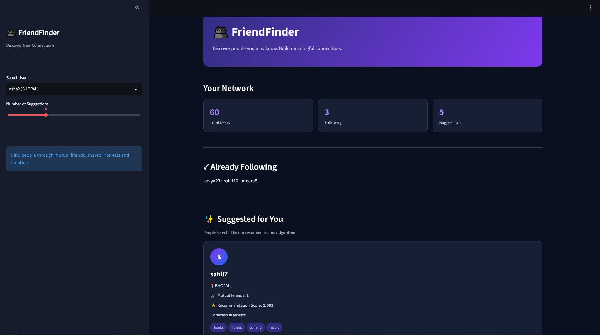
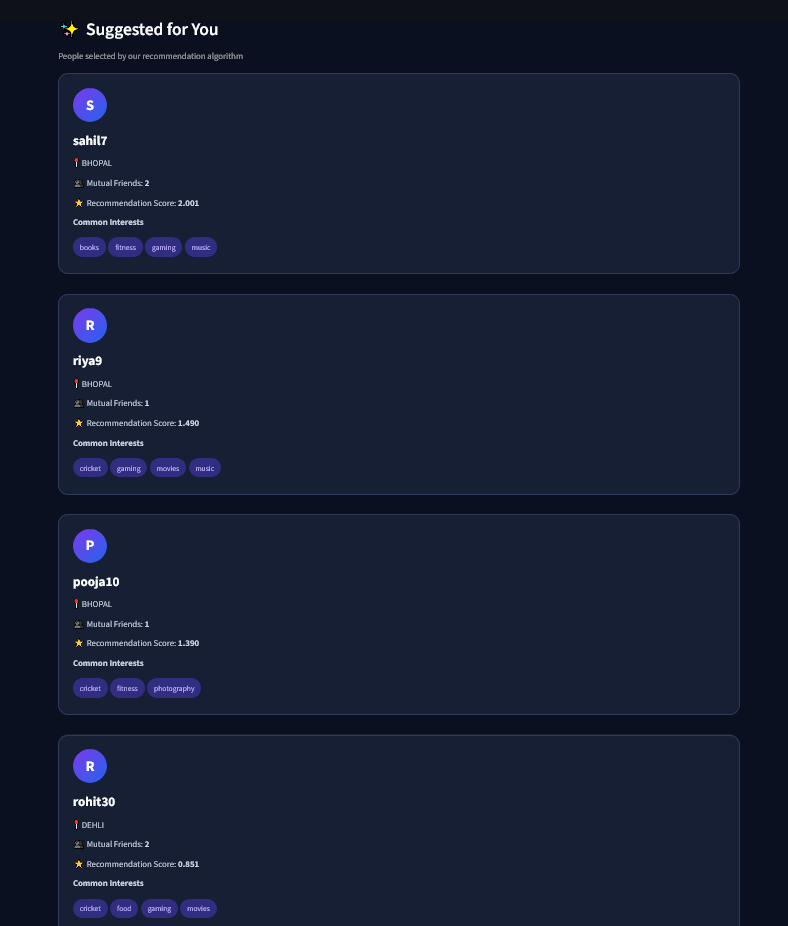

# FriendFinder – Hybrid People Recommendation System

A graph-based **hybrid recommendation system** inspired by Instagram's "Suggested for You". It recommends new people to follow by combining follow graph (mutual connections), shared interests and location.

Built with **Python, SQLite and Streamlit**.

**Note:** This is a graph / similarity-based recommendation system, not a machine-learning model.

## Features

- Follow-graph recommendations (2-hop candidates: friends of friends)
- **Adamic-Adar** score on mutual connections
- **Jaccard similarity** on shared interests
- **Location boost** for users in the same city
- **Top 5** suggestions per user
- Excludes users who are already followed
- Displays mutual friend count, recommendation score, city and common interests
- Hold-out evaluation using **Precision@5** against a random baseline
- Interactive **Streamlit** web interface to view suggestions for any user

## Technologies Used

- Python
- SQLite
- Streamlit
- Graph-based recommendation techniques

## Project Structure

```text
recommendation_system/
│
├── database.py          # SQLite setup and dummy data generation
├── recommender.py       # Candidate generation and scoring
├── evaluate.py          # Precision@5 evaluation
├── friendapp.py         # Streamlit application
├── requirements.txt     # Project dependencies
├── friendfinder.db      # SQLite database (generated)
│
├── screenshots/
│   ├── home.png
│   └── suggestions.png
│
└── README.md
```

## Architecture

```text
SQLite DB (users, follows)
        |
        v
Load graph (following / followers sets)
and user profiles (city, interests)
        |
        v
Candidate generation
(2-hop, exclude self and already followed)
        |
        v
Scoring
(Adamic-Adar + 0.5 x interest Jaccard + city boost)
        |
        v
Top 5 Ranking
        |
        v
Streamlit UI / Evaluation
```

## Recommendation Algorithm

For a user `u`:

1. **Candidates:** Everyone followed by the people `u` follows (2-hop), excluding `u` and people `u` already follows.
2. **Mutual connections:** Users that `u` follows who also follow candidate `c`.
3. **Scoring:** Each candidate is scored using three signals.
4. **Ranking:** Candidates are sorted by score (highest first), and the Top 5 are returned along with their mutual connection count.

### Formulas

**1. Adamic-Adar (Mutual Connections)**

```text
AA(u, c) = Σ 1 / ln(max(deg(m), 2))
```

For each `m` in `mutual(u, c)`.

`deg(m)` = number of followers + number of people `m` follows.

Mutual connections with fewer total connections contribute more because a rarer connection is considered more meaningful.

**2. Jaccard Similarity (Interests)**

```text
J(u, c) = |I(u) ∩ I(c)| / |I(u) ∪ I(c)|
```

`I(x)` = set of interests of user `x`.

**3. Location Boost**

```text
L(u, c) = 1.0 if same city, else 0.0
```

**4. Final Score**

```text
score(u, c) = AA(u, c) + 0.5 * J(u, c) + L(u, c)
```

## Database Schema

SQLite database (`friendfinder.db`) contains two tables:

| Table | Columns |
|---|---|
| users | `id` (Primary Key, autoincrement), `username` (unique), `city`, `interests` (comma-separated) |
| follows | `follower_id`, `following_id` (composite Primary Key, both reference `users.id`) |

A user cannot follow themselves.

### Dummy Data

Generated by `database.py` using a fixed `random.seed(42)` for reproducibility.

- **60 users**, each with a random city from 6 cities: Bhopal, Indore, Delhi, Mumbai, Pune and Jaipur.
- Each user has 2–4 interests selected from 10 interests.
- **423 follow edges:** Each user follows 3–12 other users, selected through weighted random choice.
- Users in the same city and users with more shared interests have a higher probability of being followed.

## Installation and Execution

**1. Clone the repository**

```bash
git clone YOUR_GITHUB_REPOSITORY_URL
cd recommendation_system
```

**2. Install dependencies**

```bash
pip install -r requirements.txt
```

**3. Generate the database and dummy data**

```bash
python database.py
```

**4. Run evaluation (optional)**

```bash
python evaluate.py
```

**5. Launch the Streamlit application**

```bash
streamlit run friendapp.py
```

## Evaluation

**Method: Hold-out evaluation (`evaluate.py`)**

1. For every user, randomly hide 20% of their real follows (at least 1) as the test set.
2. Use the remaining 80% to build the graph.
3. Generate the Top 5 recommendations for each user using the reduced graph.
4. A recommendation is correct if it appears in that user's hidden follows.
5. **Precision@5** = Correct recommendations in Top 5 / 5, averaged over all users.
6. **Random baseline:** Five randomly selected users (excluding the target user), evaluated using the same hidden test set.

A fixed `seed=42` is used for reproducibility.

### Results

| Method | Precision@5 |
|---|---:|
| FriendFinder (Hybrid) | 0.033 |
| Random Baseline | 0.017 |

**Limitation:** FriendFinder performs better than the random baseline, but the absolute precision is still low. The dataset is small and synthetic (60 users), and only 1–2 follows per user are hidden. Therefore, these results are low and noisy.

The synthetic follows are also generated with a same-city / shared-interest bias, which the scoring system can pick up. Testing on a larger or real-world dataset is future work.

## Screenshots

### Home Page



### Friend Suggestions



## Future Scope

- Show the names of mutual friends (currently only the count is displayed).
- Tune scoring weights for better recommendations.
- Add more recommendation signals (activity, followback).
- Test on a larger / real-world dataset.
- Explore real-time recommendation updates.

## Project Type

**Graph-based Hybrid Recommendation System**

This project uses graph algorithms and similarity-based scoring techniques, not a machine-learning model.

## Author

**Vaishnavi Prajapati**

MCA, Bansal Institute of Research Technology & Science, Bhopal